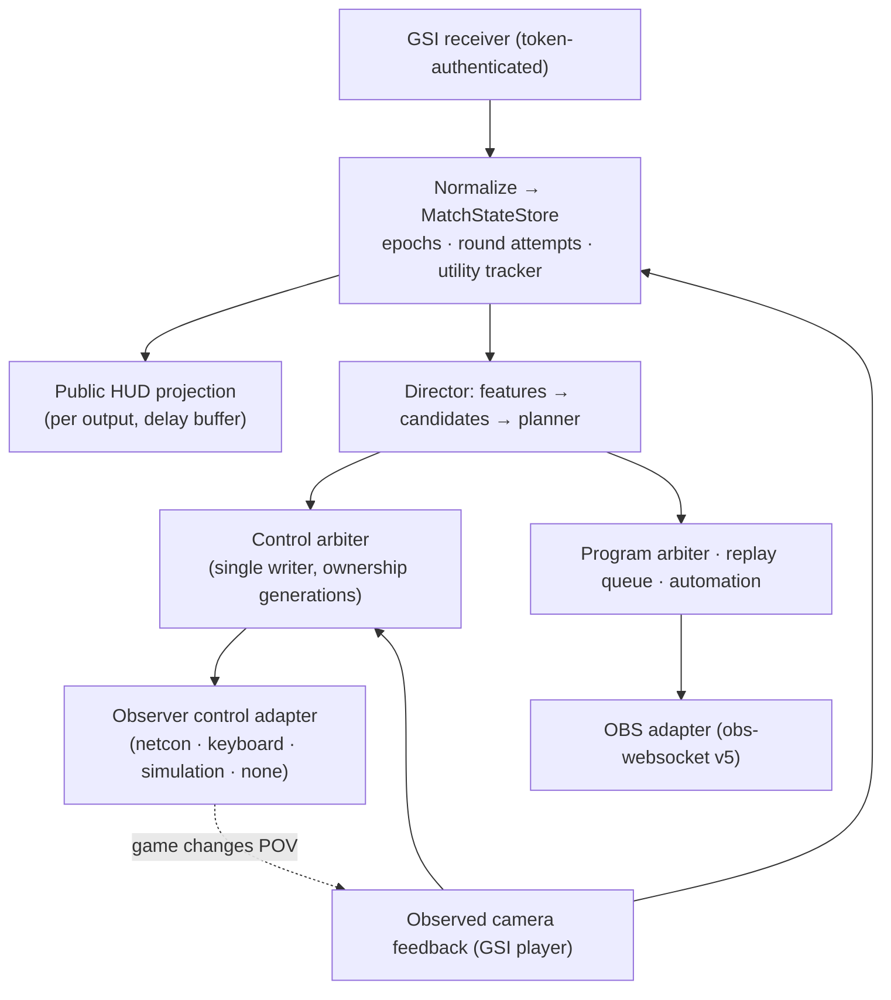

# Architecture overview

Matchframe Esports is two products. **The Matchframe program for Windows** (`.exe` installer) is everything that runs a broadcast: a modular monolith with one authoritative local engine per match session, the operator console shown only inside the program, browser-source HUD outputs for OBS, and separate Python workers for offline demo work. **The website** (`services/cloud-api` + `apps/cloud-web`) only handles payments, subscriptions, auto-director hours usage, account and team management, and staff administration ([cloud.md](cloud.md)).

**Where the console runs.** The program shows the operator console from its own `app://matchframe` origin (files bundled in the installer) and forwards the console's API requests to the engine. The engine's HTTP address serves the API (for the program and control surfaces such as Companion), the captain veto page for scoped captain links, and — on the overlay port — the HUD outputs that OBS browser sources load. It never serves the console to a browser. Extra operator positions in a multi-PC production run the same program connected to the production computer (File → Connection settings).

## State and control topology

This is the metadata/control topology, not video transport. CS2 renders game video; OBS (or another mixer) captures and composites it. WebSockets carry metadata only.

## Components

| Path | Responsibility |
|---|---|
| `packages/contracts` | Versioned zod schemas: capabilities, canonical match state, utility items, commands, decisions, map packs, HUD manifests, domain records, job states. |
| `packages/cs2-state` | GSI schema/normalizer (absent vs empty vs null), MatchStateStore (epochs, round attempts, duplicates/out-of-order, side swaps), match clock, derived events with evidence levels, universal utility tracker, capability sampler, synthetic payload builder. |
| `packages/map-runtime` | Map packs: region/level lookup, floor grid, radar/schematic transforms, camera coverage, `getpos` authoring, path checks, revision invalidation, coverage rows. |
| `packages/director-policy` | Interaction features, readiness, significance, utility opportunities and scenario rules, candidate scoring (baseline-1), hysteresis planner, `Director`, `ControlArbiter`, `ObserverControlAdapter`, GBDT evaluator. |
| `packages/automation` | Typed signal rules: triggers, conditions, cooldown/debounce/dedupe, priorities, program modes, dry run, no replay after reconnect. |
| `packages/obs-adapter` | obs-websocket v5 manager: discovery, reconnect, confirmed set operations, provisioning without replacement, replay saves confirmed by event. |
| `packages/game-adapters` | `GameAdapter` interface, VDF parser, CS2 Steam discovery, GSI config writer. |
| `packages/hud-sdk` | Public HUD state type, read-only client, clock helpers (also bundled for imported HUD packages at `/sdk/hud-sdk.js`). |
| `packages/matchframe-bridge` | Optional MatchFrame service bridge client (documented contract). |
| `services/local-engine` | Composition root: SQLite repositories, LiveSession, servers (GSI/API/overlay), routes, domain services (veto, series, sponsors, program), HUD packages/outputs, demo library, simulation. |
| `services/observer-agent` | Observer control adapters. |
| `services/replay-agent` | Replay providers and approval queue. |
| `apps/hud-renderer` | Built-in broadcast HUD (React), three presets, nine variants. |
| `apps/operator-web` | Operator console (React), bundled into the program; separate captain veto page build (`dist-captain`) served by the engine. |
| `apps/desktop` | The Matchframe program: Electron shell with the `app://matchframe` console origin and API forwarding, engine supervisor, connection settings (this computer / production computer), packaging (NSIS `.exe`, portable zip). |
| `services/cloud-api`, `apps/cloud-web` | The website: accounts, organisations, Stripe billing, auto-director hours, linking computers, staff admin, installer downloads. |
| `workers/*` | Python demo parsing, features, training, evaluation (see `workers/README.md`). |

## Clocks and timing (spec §6.5)

- **Ingest monotonic time** (`performance.now()`) stamps every observation; all freshness, expiry and timeouts use it.
- **Source time**: GSI `provider.timestamp` has 1 s resolution; it is used only to reject clearly out-of-order packets.
- **Canonical match time**: `MatchClock` advances with ingest time only while play is live and unpaused, resets per epoch; uncertainty ≥ mean packet interval + 50 ms. It is not frame-accurate and is reported with its uncertainty.
- **Observer render / program presentation time**: not observable from GSI. Delayed outputs use a per-output delay buffer; true multi-client alignment (lookahead) needs measured offsets between sources (see FEATURE_COVERAGE F17).
- Countdowns (round/bomb) extrapolate locally only while running and for at most 1.5 s past the last authoritative update; they freeze during pauses and source gaps.

## Ownership and safety

- One `ControlArbiter` per observer. Owners: operator, director, device, remote. Every takeover increments the ownership generation; commands carry the generation, session, epoch and an absolute expiry and are rejected when any of these are stale.
- Manual takeover is sticky. Resume is explicit (optional cancellable countdown). The engine starts — and restarts — disarmed.
- Unexplained POV changes under automation trigger manual takeover, except the game's auto-switch after the observed player dies.
- A transport acknowledgement (bytes written, key sent) is never reported as a confirmed camera change.
- Automatic POV cuts are blocked until player-selection control has been verified by a real setup test; automatic cinematics require verified static-camera control and validated cameras.
- Stale telemetry stops automated commands in flight and falls back to manual.

## Projections

- **Operator** (`/api/v1/ws`, authenticated): canonical state, director decision with candidates and reasons, opportunities, ownership, capabilities, program, OBS, metrics.
- **Public** (`/overlay-ws`, per-output token): `HudState` only — no predictions, candidates or operator data; delayed outputs read from the delay buffer.

## Persistence

SQLite (`<dataDir>/matchframe.sqlite`): documents (teams, players, events, matches, sponsors, rundown, rules, setup profiles, outputs, corrections), roster memberships with validity ranges, map instances, veto decisions (unique active decision per step), audit log, HUD packages, output revisions, demo jobs + transitions, settings, sponsor deliveries, replay clips. High-volume decision/event history is kept in bounded in-memory logs and the structured log files, not in SQLite.
